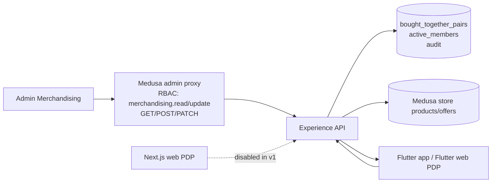
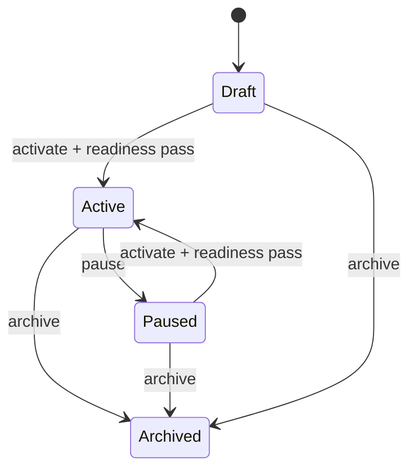

# Bought Together merchandising — product pair design

- Date: 2026-10-25
- Status: Approved for staging implementation after GPT-5.6 Sol QC 3; Change Contract required before code
- Scope: Admin Merchandising configuration + customer product page section on Flutter app/web
- Environment: Staging only. Production remains unauthorized.
- Related: Product workspace spec, CHG-076, CHG-078

## 1. Objective

Add one explicit merchandising unit to the product page:

> **Bought together** — the product being viewed plus one other product, shown together immediately above the Related products swimlane.

The pair is configured by an operator in **Merchandising → Bought together**, as a pair of exactly two products. The relationship is reciprocal: if Product A is paired with Product B, A's page shows B and B's page shows A.

This is not an algorithmic recommendation. It is an explicit, auditable merchandising decision.

## 2. Non-goals

- No automatic "frequently bought together" inference from orders in v1.
- No bundles, kit pricing, or discount rules in v1.
- **No combined add-to-cart/RFQ in v1.** Each product keeps its existing individual action. A combined action needs a separate atomic server batch contract and review.
- No scheduling or expiry in v1. A pair is draft, active, paused or archived.
- **No archive restore in v1.** Archived pairs are retained for audit; create a new pair to reinstate the relationship.
- No seller-facing pair configuration. Admin/Merchandiser only.
- No variant-level pairing. Pairing is at product level.
- No CMS/Strapi dependency. Pairs are relational merchandising data, not editorial content.
- No production release.

## 3. Customer-facing behaviour

### 3.1 Placement

Bought together sits **above Related products** and below the product's specifications/trust block.

Order on the B2C product page:

1. Media and identity
2. Price and variants
3. Seller/offer and availability
4. Primary actions
5. Specifications / delivery / trust
6. **Bought together**
7. Related products

B2B product page today has no Related products rail. It ends after the primary actions. Place Bought together **after the primary actions**, at the end of the page. If a Related products rail is added to the B2B PDP later, keep Bought together immediately above it.

If no active pair exists, or the pair is not ready, the section is omitted. Related products remains unchanged.

### 3.2 Section content

The section shows:

- Section title: **Bought together**
- Helper line: "Recommended with this item." Do not claim "often purchased" unless the pair is order-derived.
- Current product: compact row/card with image, title, price, availability, labelled **This item**.
- Paired product: compact row/card with image, title, price, availability, seller and its own action when available. When the paired product is out of stock, show identity and **Out of stock** only.
- A visible `+` / "Pair with" marker between them.

The current product is always shown first. On the paired product's own page, the cards reverse, because the pair is symmetric.

**No combined total and no combined CTA in v1.** The section recommends the second product; the customer adds or requests each product through its existing product action. This avoids unsafe partial adds, cross-seller cart assumptions and B2B total/GST ambiguity.

### 3.3 Mobile and desktop layout

Mobile (360 px) uses stacked compact rows, not two dense side-by-side cards:

```text
+------------------------------------------+
| Bought together                          |
| Recommended with this item.              |
|                                          |
| This item                                |
| [img] 1/2in Drive Socket Set             |
|       ₹3,890 · In stock                  |
|                                          |
|              + Pair with                 |
|                                          |
| [img] 3/8in Ratchet Handle               |
|       ₹1,250 · BuildMaster · In stock    |
|       [ Add to cart ]                    |
+------------------------------------------+
```

Desktop/tablet uses two columns with the paired action on the right card. Do not shrink two full product cards into 360 px.

### 3.4 Variant behaviour

Pairing is product-level, not variant-level.

- Current product: uses the variant the customer has selected; the section does not duplicate the main CTA.
- Paired product:
  - **Direct action only when exactly one channel-eligible, priced, in-stock variant exists.** Then show **Add to cart** (B2C) or **Add to RFQ** (B2B).
  - If more than one channel-eligible variant exists, show **From ₹X** and **Choose options**. Navigate to the paired product. Do not silently choose an arbitrary variant.
  - If the product has no channel-eligible offer, the section is hidden.
- The paired action must use the same price and quantity logic as the existing product card/RFQ line.

### 3.5 Channel behaviour

A pair can be configured for B2C, B2B, or both.

| Surface | Price block | Quantity | Action |
|---|---|---|---|
| B2C | Selling price, MRP/discount | 1 default | Add to cart |
| B2B | Trade price, MRP, MOQ, tier hint | Existing PDP default tier/MOQ | Add to RFQ |

B2C never reads B2B pricing. B2B uses the existing B2B composition rules, including the `buildkart_b2b_pricing` snapshot and effective-date window.

**No GST line in the Bought together card in v1.** The composed B2B offer currently exposes `b2b_configured`, `b2b_moq` and `b2b_tiers`, but not `gst_inclusive`; do not promise a GST display the contract cannot support. The main B2B PDP continues to show its existing GST line.

### 3.6 Availability and failure states

| State | Customer result |
|---|---|
| No pair configured | Section hidden |
| Pair draft, paused or archived | Section hidden |
| Current or paired product unpublished/deleted | Section hidden; admin health `unavailable` |
| Current or paired product has no channel-eligible offer | Section hidden; admin health `unavailable` |
| Current product is out of stock | Section hidden in v1; the main PDP already owns the out-of-stock state |
| Paired product has offers but all are out of stock | Show paired identity (image/title) + **Out of stock**; no price/seller; action disabled |
| Pair lookup/composition fails or times out | PDP still renders; section hidden; error logged with pair/channel/correlation id |
| Both in stock | Full section with individual actions |

The section is progressive enhancement. It must never block or fail the product page.

## 4. Admin experience

### 4.1 Navigation

Add **Bought together** under **Merchandising**, visible only when the actor has `merchandising.read`.

Current Merchandising group:

- Banners
- Storefront layouts
- **Bought together** (new)

Route: `/merchandising/bought-together`

### 4.2 List page

Header: **Bought together**
Helper: "Pair two products. Each product page shows the other above Related products."

Summary counters:

- Active
- Paused
- Needs attention (`unavailable` / `out_of_stock`)
- Draft

Filters:

- Search by product title or SKU
- Channel: All / B2C / B2B
- Status: All / Draft / Active / Paused / Archived

Table columns:

| Column | Content |
|---|---|
| Pair | Two thumbnails + titles, `A + B` |
| Channel | B2C / B2B / B2C + B2B |
| Status | Draft / Active / Paused / Archived |
| Health | Ready / Out of stock / Unavailable |
| Updated | Actor and timestamp |
| Actions | Edit, Pause/Activate, Archive, Audit |

Empty state: "No pairs yet. Pair two products to show them together on both product pages."

### 4.3 Create/edit drawer

Fields:

- **Product A** — searchable picker. Shows thumbnail, title, SKU count, publication status, channel readiness.
- **Product B** — same picker. Cannot equal Product A.
- **Channel** — B2C / B2B / Both. Default B2C.
- **Status** — Draft / Active / Paused. Default Draft.
- **Preview** — B2C/B2B tabs, because a `Both` pair can look different per channel.

Actions:

- Save draft
- Save and activate
- Cancel

Validation:

- Product A and Product B are required and must differ.
- **v1 candidate search is limited to published, store-visible products.** Draft/unpublished products cannot be selected. This avoids needing an admin product-read boundary in the Experience API.
- Activation requires both products to be published and each to have at least one channel-eligible offer in every selected channel.
- A product cannot be in more than one active pair for the same channel.
- A non-archived pair of the same two products cannot be duplicated, regardless of channel. Use the channel field on the existing pair instead of creating a second A+B row.
- If a product is already paired, the drawer shows the existing pair and a link to edit or pause it. It does not silently replace it.
- No reason-for-change field. Audit is automatic.

### 4.4 Admin wireframe

```text
+----------------------------------------------------------------------------------+
| Merchandising / Bought together                                                  |
| Pair two products. Each product page shows the other above Related products.     |
|                                                                    [ New pair ]  |
+----------------------------------------------------------------------------------+
| Active 12     Paused 3     Needs attention 1     Draft 2                          |
+----------------------------------------------------------------------------------+
| Search products...             Channel [All v]        Status [All v]             |
+----------------------------------------------------------------------------------+
| Pair                                  | Channel  | Status  | Health   | Updated   |
| [img] Socket Set + [img] Ratchet      | B2C + B2B| Active  | Ready    | 25 Oct    |
| [img] Drill + [img] Bit Set           | B2C      | Active  | Out of   | 24 Oct    |
|                                       |          |         | stock    |           |
| [img] Tape + [img] Knife              | B2B      | Paused  | Unavailable | 24 Oct |
+----------------------------------------------------------------------------------+
```

```text
+------------------------------------------+
| New pair                            [x]  |
| Pair two products.                       |
|                                          |
| Product A                                |
| [ Search product...                    ] |
| [img] 1/2in Drive Socket Set             |
|       SKU 2 · Published · B2C/B2B ready  |
|                                          |
|                  +                       |
|                                          |
| Product B                                |
| [ Search product...                    ] |
| [img] 3/8in Ratchet Handle               |
|       SKU 1 · Published · B2C ready      |
|                                          |
| Channel   [ B2C ] [ B2B ] [ Both ]       |
| Status    [ Draft v ]                    |
|                                          |
| Preview   [ B2C ] [ B2B ]                |
| +----------------+  +  +----------------+|
| | This item      |     | Pair with      ||
| | ₹3,890         |     | ₹1,250         ||
| +----------------+     +----------------+|
|                                          |
| [ Cancel ]                 [ Save pair ] |
+------------------------------------------+
```

## 5. Storefront wireframes

### 5.1 App — B2C (mobile)

```text
... specifications / delivery / trust ...

+------------------------------------------+
| Bought together                          |
| Recommended with this item.              |
|                                          |
| This item                                |
| [img] 1/2in Drive Socket Set             |
|       ₹3,890 · In stock                  |
|                                          |
|              + Pair with                 |
|                                          |
| [img] 3/8in Ratchet Handle               |
|       ₹1,250 · BuildMaster · In stock    |
|       [ Add to cart ]                    |
+------------------------------------------+
| Related products                         |
| [ swimlane ... ]                         |
+------------------------------------------+
```

### 5.2 App — B2B (mobile)

```text
... primary actions ...

+------------------------------------------+
| Bought together                          |
| Recommended with this item.              |
|                                          |
| This item                                |
| [img] 1/2in Drive Socket Set             |
|       ₹3,890 · MOQ 5 · 5+ ₹3,890         |
|                                          |
|              + Pair with                 |
|                                          |
| [img] 3/8in Ratchet Handle               |
|       ₹1,250 · MOQ 10 · 10+ ₹1,150       |
|       [ Add to RFQ ]                     |
+------------------------------------------+
```

### 5.3 Web — B2C / B2B

```text
+----------------------------------------------------------------------------------+
| Bought together                                                                  |
| +----------------+   +   +----------------+                                     |
| | This item      |       | Pair with      |                                     |
| | [image]        |       | [image]        |                                     |
| | Socket Set     |       | Ratchet        |                                     |
| | ₹3,890         |       | ₹1,250         |                                     |
| | In stock       |       | In stock       |                                     |
| |                |       | [ Add to cart ]|                                     |
| +----------------+       +----------------+                                     |
+----------------------------------------------------------------------------------+
| Related products                                                                 |
+----------------------------------------------------------------------------------+
```

## 6. Data ownership and model

### 6.1 Ownership decision

**Experience API owns the pair store and the storefront read path.**

Why not CMS/Strapi:

- A pair is relational: two product IDs, channel-scoped uniqueness, and product readiness.
- The CMS content model is editorial and locale-oriented; forcing pair uniqueness and product validation into generic CMS documents would be brittle.
- The storefront already composes product data, offers, channel pricing and inventory in the Experience API. The pair lookup belongs beside that composition.
- Existing Experience-owned data plus Admin proxy is already the pattern used by search insights, inventory requests and shipments.

The Admin app calls the Medusa backend; the backend proxies to the Experience API with the operator identity. The Experience API stores the pair, validates it against Medusa store-visible product data, and serves it on the PDP.



### 6.2 Tables

```sql
CREATE TABLE bought_together_pairs (
  id              text PRIMARY KEY,
  product_a_id    text NOT NULL,
  product_b_id    text NOT NULL,
  channel         text NOT NULL CHECK (channel IN ('b2c', 'b2b', 'both')),
  status          text NOT NULL CHECK (status IN ('draft', 'active', 'paused', 'archived')),
  version         integer NOT NULL DEFAULT 1,
  -- Canonical unordered product-pair identity. Channel is deliberately excluded:
  -- one non-archived row owns the relationship across its selected channels.
  pair_key        text GENERATED ALWAYS AS (
                    least(product_a_id, product_b_id) || ':' ||
                    greatest(product_a_id, product_b_id)
                  ) STORED,
  created_by      text NOT NULL,
  updated_by      text NOT NULL,
  created_at      timestamptz NOT NULL DEFAULT now(),
  updated_at      timestamptz NOT NULL DEFAULT now(),
  test_data       boolean NOT NULL DEFAULT true CHECK (test_data = true),
  CHECK (product_a_id <> product_b_id)
);

-- Archived rows are retained for audit but must not block recreating the pair.
CREATE UNIQUE INDEX bought_together_pairs_non_archived_pair_key
  ON bought_together_pairs (pair_key)
  WHERE status <> 'archived';

-- One active pair per product, per channel. This is the integrity guard.
CREATE TABLE bought_together_active_members (
  product_id      text NOT NULL,
  channel         text NOT NULL CHECK (channel IN ('b2c', 'b2b')),
  pair_id         text NOT NULL REFERENCES bought_together_pairs(id) ON DELETE CASCADE,
  PRIMARY KEY (product_id, channel)
);

CREATE TABLE bought_together_audit (
  id              bigserial PRIMARY KEY,
  pair_id         text NOT NULL,
  action          text NOT NULL,
  actor_id        text NOT NULL,
  correlation_id  text,
  before          jsonb,
  after           jsonb,
  created_at      timestamptz NOT NULL DEFAULT now()
);
```

Notes:

- One non-archived row owns an unordered product pair, regardless of channel. `A+B` with `channel='both'` is one row and two active-member rows.
- To show A+B only on B2C, set `channel='b2c'`. To show it on both, edit the same row to `both`. Do not create a second A+B row.
- To show a different partner on B2B for product A, create a different product pair (A+C). This is a different `pair_key`, so it is allowed.
- `draft`, `paused` and `archived` pairs have no active members, so their products are free for another active pair.
- Archived rows do not block recreating the same product pair; there is no restore in v1.
- No price, stock, seller name or title is stored in these tables. Those are read live from Medusa/offers.
- No scheduling columns in v1.

### 6.3 Lifecycle



No `Scheduled`, `Expired` or `Restored` state in v1. Archived is terminal for that row; create a new pair to reinstate.

## 7. API contract

### 7.1 Admin API (Experience API, proxied by Medusa)

`GET /v1/admin/merchandising/bought-together`

Query: `query`, `channel`, `status`, `limit`, `offset`.

Response rows (one per pair row):

```json
{
  "items": [
    {
      "id": "btp_...",
      "channel": "both",
      "status": "active",
      "version": 3,
      "products": [
        { "id": "prod_...", "title": "...", "thumbnail": "...", "sku_count": 2, "status": "published", "channel_ready": { "b2c": true, "b2b": true } },
        { "id": "prod_...", "title": "...", "thumbnail": "...", "sku_count": 1, "status": "published", "channel_ready": { "b2c": true, "b2b": true } }
      ],
      "health": "ready",
      "health_by_channel": { "b2c": "ready", "b2b": "out_of_stock" },
      "updated_by": "admin@buildkart.test",
      "updated_at": "2026-10-25T10:00:00.000Z"
    }
  ],
  "count": 1,
  "limit": 20,
  "offset": 0
}
```

`health` is `ready`, `out_of_stock` or `unavailable`. Because the Store API cannot distinguish unpublished from deleted, both collapse to `unavailable`. For `channel='both'`, `health_by_channel` reports each channel and the aggregate `health` uses the precedence `unavailable > out_of_stock > ready`.

`POST /v1/admin/merchandising/bought-together`

```json
{
  "product_a_id": "prod_...",
  "product_b_id": "prod_...",
  "channel": "both",
  "status": "active"
}
```

`PATCH /v1/admin/merchandising/bought-together/:id`

Partial update with optimistic concurrency:

```json
{
  "expected_version": 3,
  "product_b_id": "prod_...",
  "channel": "b2c",
  "status": "active"
}
```

`archived` is terminal. PATCH on an archived row returns `409 archived_pair` for every mutation except audit reads. Recreating the relationship requires POST.

`GET /v1/admin/merchandising/bought-together/:id/audit`

Returns the audit trail, newest first.

`GET /v1/admin/merchandising/bought-together/candidates?query=&channel=`

Returns published, store-visible product candidates with `sku_count`, `channel_ready`, and any existing active pair. It never returns draft/unpublished products in v1.

Error codes:

| HTTP | Code | Meaning |
|---|---|---|
| 400 | `invalid_pair` | Same product, missing product, invalid channel |
| 404 | `product_not_found` | Product does not exist or is not store-visible |
| 409 | `product_already_paired` | Product already active in that channel |
| 409 | `pair_not_ready` | Product has no channel-eligible offer |
| 409 | `pair_exists` | Non-archived pair for the same two products already exists |
| 409 | `stale_pair` | `expected_version` does not match |
| 409 | `archived_pair` | The row is archived and terminal |
| 409 | `pair_conflict` | Concurrent activation conflict |

**Proxy transport:** extend `experienceAdminFetch` to support `PATCH` and preserve `x-operator-user-id`, `x-correlation-id`, service secret and seller headers. Add a proxy contract test for PATCH.

### 7.2 PDP pair endpoint

Canonical read for both B2C and B2B:

`GET /v1/products/:id/bought-together?channel=b2c|b2b`

Why a dedicated endpoint:

- The B2B PDP is built from the composed catalogue list, not `GET /v1/products/:id`. It needs a pair read that does not assume a product-detail fetch.
- The B2C PDP can call this endpoint in parallel with its existing product fetch.
- It keeps the pair contract out of the core product payload and lets the section fail independently.

**Channel enforcement:** resolve the effective channel with the existing `requestedChannel(requested, authorization)` helper. An anonymous or consumer caller sending `?channel=b2b` must be downgraded to B2C, not trusted.

**Both-product revalidation:** fetch and compose the current product and the paired product in the effective channel. Return a pair only when both are ready. This prevents a stale pair from surviving after the current product loses its offer. If the current product is out of stock, suppress the section in v1; the main PDP already owns that state.

Response when ready:

```json
{
  "pair_id": "btp_...",
  "channel": "b2c",
  "paired_availability": "in_stock",
  "paired": {
    "id": "prod_...",
    "title": "3/8in Ratchet Handle",
    "thumbnail": "...",
    "description": "...",
    "handle": "3-8in-ratchet-handle",
    "metadata": null,
    "categories": [],
    "badges": [],
    "variants": [
      {
        "id": "variant_...",
        "title": "Default",
        "sku": "RATCHET-38",
        "metadata": null,
        "best_price": {
          "id": "offer_...",
          "seller_id": "sel_...",
          "seller_name": "BuildMaster Supplies",
          "variant_id": "variant_...",
          "sku": "RATCHET-38",
          "currency_code": "INR",
          "unit_amount_minor": 125000,
          "list_amount_minor": 150000,
          "selling_amount_minor": 125000,
          "discount_minor": 25000,
          "discount_percent": 17,
          "price_source": "price_list",
          "b2b_configured": false,
          "b2b_moq": null,
          "b2b_tiers": [],
          "inventory_quantity": 12,
          "in_stock": true,
          "stock_badge": "in_stock"
        },
        "offer_count": 1,
        "in_stock": true
      }
    ],
    "best_price": {
      "id": "offer_...",
      "seller_id": "sel_...",
      "seller_name": "BuildMaster Supplies",
      "variant_id": "variant_...",
      "sku": "RATCHET-38",
      "currency_code": "INR",
      "unit_amount_minor": 125000,
      "list_amount_minor": 150000,
      "selling_amount_minor": 125000,
      "discount_minor": 25000,
      "discount_percent": 17,
      "price_source": "price_list",
      "b2b_configured": false,
      "b2b_moq": null,
      "b2b_tiers": [],
      "inventory_quantity": 12,
      "in_stock": true,
      "stock_badge": "in_stock"
    },
    "offer_count": 1,
    "image_quality_score": 1,
    "image_quality_fixture": null
  },
  "environment": "staging",
  "test_data": true,
  "correlation_id": "..."
}
```

Response when the paired product exists in the channel but all offers are out of stock:

```json
{
  "pair_id": "btp_...",
  "channel": "b2c",
  "paired_availability": "out_of_stock",
  "paired": {
    "id": "prod_...",
    "title": "3/8in Ratchet Handle",
    "thumbnail": "...",
    "handle": "...",
    "variants": [],
    "best_price": null,
    "offer_count": 1
  },
  "environment": "staging",
  "test_data": true,
  "correlation_id": "..."
}
```

Out-of-stock cards show identity only: image, title, **Out of stock**, no price/seller, disabled action. This avoids inventing a display price the existing `composeOffers` selected contract does not expose.

Response when no ready pair exists:

```json
{ "pair_id": null, "channel": "b2c", "paired": null }
```

The client treats `paired: null` as "no section". A pair-store or Medusa failure must not fail the PDP; return `paired: null` and log the error with correlation id.

`paired` otherwise reuses the **same composed product list-item contract** already returned by `GET /v1/products` and consumed by the Flutter `Product`/`TradeProduct` models. Do not introduce a second price model.

### 7.3 Read sequence

```mermaid
sequenceDiagram
    participant C as Customer app/web
    participant E as Experience API
    participant DB as Pair store
    participant M as Medusa

    C->>E: GET /v1/products/:id/bought-together?channel=b2c
    E->>E: resolve effective channel from identity
    E->>DB: active pair for product/channel
    alt pair exists
        E->>M: current product + offers
        E->>M: paired product + offers
        E->>E: compose both; require both ready
        E-->>C: paired summary or out_of_stock
    else no pair / not ready / store failure
        E-->>C: paired:null
    end
```

The pair lookup is one indexed query. The two product compositions run in parallel and reuse `composeOffers`/`composeVariantPrices`. Bound optional work with a timeout; the main PDP request is already complete and independent.

## 8. Rules and edge cases

### 8.1 Pair rules

1. Exactly two distinct products.
2. One active pair per product, per channel.
3. One non-archived pair per unordered product pair, regardless of channel.
4. Pair is symmetric.
5. No self-pairing.
6. A+B and B+A for the same non-archived pair are rejected by `pair_key`.
7. `channel='both'` is one pair row with two active-member rows.
8. Different B2C and B2B partners for the same product are allowed as different product pairs (A+B and A+C).
9. Archived rows do not block recreation; no restore in v1.

### 8.2 Readiness rules

A pair can be active only when, for each selected channel:

- Both products exist and are store-visible.
- Both products are published.
- Both products have at least one channel-eligible offer (in stock or out of stock).

Readiness is rechecked at activation and at read time, for both products. If the current product loses its offer, the section is hidden. If the paired product has only out-of-stock offers, the section shows the out-of-stock state.

### 8.3 Pricing rules

- B2C: use the standard B2C selected offer. Show selling price and MRP/discount if available.
- B2B: use the standard B2B composition, including B2B snapshot, MOQ and tiers.
- Never copy a price into the pair record.
- Never show a B2B price on a B2C page, or the reverse.
- No combined total and no GST line in v1.
- When all offers are out of stock, show identity only, no price/seller.

### 8.4 Paired action rules

| Situation | Action |
|---|---|
| Exactly one channel-eligible, priced, in-stock variant | **Add to cart** / **Add to RFQ** using existing product/RFQ logic |
| More than one channel-eligible variant | **Choose options**; navigate to the paired product |
| All offers out of stock | Show **Out of stock**; disable action |
| No channel-eligible offer / unpublished / deleted | Hide the section |
| Cross-seller pair | Allowed; each product keeps its own seller/action. No combined add. |
| B2B | Use the existing default tier/MOQ quantity for the RFQ line |

### 8.5 Product lifecycle

- Product unpublished: section hidden; admin health `unavailable`.
- Product deleted: section hidden; admin health `unavailable` (Store API cannot distinguish this from unpublished in v1).
- Seller changes: pair remains product-level; seller names are read live.
- Offer removed: section hidden if no channel-eligible offer; admin health `unavailable`.
- Stock reaches zero: section remains with **Out of stock**; admin health `out_of_stock`.

## 9. Permissions, staging and audit

### 9.1 Permissions

- Add `merchandising.read` and `merchandising.update` to `BUILDKART_PERMISSIONS`.
- Grant both to `catalogue_admin`; grant `merchandising.read` to `marketplace_admin`; `super_admin` inherits all.
- Enforce the permission at the Medusa admin route boundary before proxying to Experience API.
- Hide/disable the Merchandising navigation item when `merchandising.read` is absent.
- In Experience API, map `/v1/admin/merchandising/bought-together` explicitly to `marketplace_operator`/`super_admin` instead of relying on the generic `/v1/admin` super-admin fallback. The service identity currently carries `marketplace_operator`, so the proxy must be deliberate.
- Sellers cannot read or write the pair configuration. Seller-scoped requests return 404.

### 9.2 Staging isolation

- Add `BUILDKART_BOUGHT_TOGETHER_ENABLED`; default false.
- Staging sets it true. Production remains false and unauthorized.
- When disabled:
  - Admin page and admin API return 404.
  - PDP pair endpoint returns `paired: null` so the storefront degrades cleanly.
- Add a test that production configuration fails closed.

### 9.3 Concurrency and audit

- Create/update/activate runs in a transaction.
- Activating inserts active member rows. The `(product_id, channel)` primary key rejects a second active pair.
- The partial unique index on `pair_key` rejects duplicate non-archived product pairs.
- On conflict, return `409` with the specific code. The admin drawer shows the existing pair or conflict.
- PATCH requires `expected_version`; mismatch returns `409 stale_pair`. PATCH on an archived row returns `409 archived_pair`; archived is terminal.
- Pausing/archiving deletes active members and writes audit.
- Every create/update/activate/pause/archive writes `bought_together_audit` with actor, action, correlation id, before and after.
- No free-text reason field. The audit record is the reason trail.
- Storefront pair reads are uncached in v1. Offer composition keeps its existing 30-second cache; document that freshness window.

### 9.4 Admin health performance

Resolve health for the unique product IDs on the current page in one batch:

- Deduplicate product IDs across rows.
- Fetch products and channel offers in bounded batches (for example, 20 IDs per call).
- Apply a per-batch timeout; on timeout mark affected rows `unavailable` rather than failing the whole list.
- Cache the health result for the duration of the request only.
- Do not perform per-row N+1 reads.

## 10. Implementation slices

### Slice 0 — Design and QC (this document)

- Re-review with GPT-5.6 Sol after the second revision.
- Create a Change Contract before code. Classify as **Lane C** (UI + API + schema + security).
- Confirm the surface matrix: B2C Flutter, B2B Flutter, Flutter web; Next.js explicitly disabled.

### Slice 1 — Experience API store and read path

- Add schema/bootstrap for `bought_together_pairs`, `active_members`, `audit`.
- Add `BoughtTogetherStore` with create/update/activate/pause/archive/list/read.
- Add admin endpoints and candidate search (published/store-visible only).
- Add `GET /v1/products/:id/bought-together` with both-product revalidation, effective channel, out-of-stock state and timeout isolation.
- Add staging feature flag.
- Tests: pair lookup, channel isolation and spoofing, duplicate A+B/B+A, duplicate non-archived pair, archived recreation, concurrent activation, stale version, pause, unavailable product, out-of-stock, no pair, pair-store timeout.
- No customer UI yet.

### Slice 2 — Admin proxy and Merchandising page

- Extend `experienceAdminFetch` for `PATCH`.
- Add Medusa admin proxy routes with `merchandising.read/update`.
- Add `/merchandising/bought-together` page, list, drawer, B2C/B2B preview tabs, audit.
- Add navigation item with permission-gated visibility.
- Batch health resolution.
- Tests: create/edit/pause/archive, conflict message, readiness, preview tabs, permission denial, nav visibility, staging flag, PATCH proxy headers.

### Slice 3 — Flutter app/web product page

- Add project/provider field for `GET /v1/products/:id/bought-together`.
- Add `BoughtTogetherSection` above Related products on B2C; after primary actions on B2B.
- Stacked mobile rows, two-column desktop.
- B2C and B2B individual actions; choose-options fallback; out-of-stock identity-only state.
- Tests: renders, hidden states, channel prices, no overflow at 320/360/600 px, load failure hides section.

### Slice 4 — Staging seed and verification

- Seed one B2C pair and one B2B pair on staging.
- Verify both product pages, above Related products (B2C) and after actions (B2B).
- Verify pause hides both sides.
- Verify duplicate pair is blocked; archived pair can be recreated.
- Verify audit entries.
- Evidence note.

### Slice 5 — Next.js web

The Next.js `apps/web` product page is minimal and has no Related products. **Disable/omit Bought together in v1** and identify Flutter web as the authoritative customer web surface. Revisit parity only if Next.js is confirmed as an active staging customer surface.

## 11. Acceptance checklist

- [ ] Admin can create a pair A + B for B2C.
- [ ] A's B2C product page shows B above Related products.
- [ ] B's B2C product page shows A above Related products.
- [ ] Pair shows the correct B2C retail price.
- [ ] Pair shows the correct B2B trade price, MOQ and tier hint on B2B.
- [ ] B2B section appears after primary actions, because no Related rail exists there.
- [ ] A B2C-only pair does not appear on B2B.
- [ ] A `both` pair appears on both surfaces with channel-specific prices.
- [ ] Anonymous/consumer `?channel=b2b` resolves to B2C and never returns B2B pair prices.
- [ ] Pausing hides the section on both sides.
- [ ] A second active pair for the same product and channel is rejected with a clear message.
- [ ] A+B and B+A duplicate creation is rejected.
- [ ] A second non-archived A+B row is rejected regardless of channel.
- [ ] Archived A+B can be recreated as a new pair.
- [ ] Concurrent activation returns a deterministic 409.
- [ ] Stale PATCH with an old `expected_version` returns 409.
- [ ] PATCH on an archived pair returns 409 and cannot change status.
- [ ] An unpublished/deleted or offerless current product hides the section (both-product revalidation).
- [ ] A current product that is out of stock hides the section in v1.
- [ ] An unpublished/deleted or offerless paired product hides the section; health `unavailable`.
- [ ] A paired product with only out-of-stock offers shows identity + **Out of stock**, no price/seller, disabled action.
- [ ] No pair means no empty section; Related products is unchanged.
- [ ] A paired product with multiple channel-eligible variants shows **Choose options**.
- [ ] Exactly one channel-eligible, in-stock variant shows a direct add action.
- [ ] No combined add CTA is rendered.
- [ ] Pair-store/Medusa timeout returns `paired:null` and the PDP still renders.
- [ ] Audit records actor, action, correlation id, before/after, timestamp.
- [ ] Seller/admin permission denial, nav visibility and staging flag behavior are verified.
- [ ] Admin health is batch-resolved, not N+1.
- [ ] Mobile layout has no overflow at 320/360 px.
- [ ] Next.js does not render an unverified Bought together surface.

## 12. Resolved decisions

1. **One active pair per product per channel.** Deterministic v1; allow different B2C and B2B partners as different product pairs.
2. **Product-level pairing.** Direct action only when exactly one channel-eligible, priced, in-stock variant exists; otherwise **Choose options**.
3. **Experience API ownership.** Channel-aware relational commerce configuration, unlike the locale/editorial CMS model.
4. **Separate active-members table.** DB-enforced uniqueness, maintained transactionally.
5. **`Both` representation.** One pair row with `channel='both'`; two active-member rows (B2C, B2B), created atomically. One non-archived pair per unordered product pair, regardless of channel.
6. **No combined add in v1.** Individual actions only; a future combined action needs an atomic server batch contract.
7. **Out-of-stock paired product.** Show identity + **Out of stock**, no price/seller, disabled action; hide only no-channel-offer/unpublished/deleted.
8. **Readiness checks.** Activation plus read-time checks for both products; no scheduling/health job because scheduling is cut.
9. **Fixed title.** **Bought together**, localized by the client; no per-pair override.
10. **Placement.** B2C: above Related products. B2B: after primary actions; above a Related rail if one is added later.

## 13. QC history

### QC 1 — GPT-5.6 Sol, 2026-10-25

Verdict: **REWORK**.

Resolved in revision 1: dedicated B2B pair endpoint, published-only candidates, combined add removed, RBAC/staging guards, canonical pair key/versioning, scheduling removed, mobile stacking, shared DTO, timeout isolation, B2C/B2B previews, Next.js disabled.

### QC 2 — GPT-5.6 Sol, 2026-10-25

Verdict: **REWORK**.

Blockers raised and resolution in this revision:

| QC 2 blocker | Resolution |
|---|---|
| Archived `pair_key` permanently blocks recreation | Partial unique index on `pair_key` where `status <> 'archived'`; no restore in v1; archived recreation accepted. |
| Endpoint revalidates only the paired product | Endpoint now composes both current and paired products and requires both ready. |
| Out-of-stock card cannot be rendered from list-item DTO | Out-of-stock card is identity-only; no price/seller; explicit `paired_availability: "out_of_stock"`; action disabled. |
| `both` representation mismatch | Explicitly approved single-row `both` + two active members; one non-archived pair per unordered product pair regardless of channel; `pair_key` excludes channel. |
| Health claims unpublished vs deleted | Collapsed to `unavailable`; no `missing_product` state in v1. |
| PATCH proxy unsupported | `experienceAdminFetch` extended for PATCH; proxy contract test required. |
| GST unsupported in composed offer | No GST line in Bought together card v1; main PDP retains its GST line. |
| Admin health N+1 | Batch unique product IDs and offers with bounded concurrency/timeouts. |
| Variant eligibility inconsistency | Direct action only for exactly one channel-eligible, priced, in-stock variant. |
| Nav authorization unspecified | Nav item hidden/disabled without `merchandising.read`. |

**Status:** Closed by QC 3 APPROVE. Implementation still requires the Lane C Change Contract.

### QC 3 — GPT-5.6 Sol, 2026-10-25

Verdict: **APPROVE**.

All QC 2 blockers were closed. No new blockers. Non-blocking clarifications were incorporated into this revision:

| QC 3 clarification | Resolution |
|---|---|
| Current-product out-of-stock behavior undefined | Current product out of stock hides the section in v1; the main PDP owns that state. |
| `availability` scope ambiguous | Renamed to `paired_availability`. |
| Aggregate health for `both` undefined | Added `health_by_channel` and precedence `unavailable > out_of_stock > ready`. |
| Archived PATCH behavior undefined | Archived is terminal; PATCH returns `409 archived_pair`; recreate via POST. |
| Placeholder ready-response fixture | Replaced with a coherent list-item fixture using existing variant/offer fields. |
| Paired card copy implied price/seller always | Qualified with "when available"; out-of-stock is identity-only. |
| Partial index name misleading | Renamed to `bought_together_pairs_non_archived_pair_key`. |

**Approval conditions:** create and approve a governed **Lane C** Change Contract before coding; implement the partial unique index and lifecycle tests as written; enforce effective-channel lookup, both-product revalidation, RBAC, PATCH proxy headers and the default-off staging guard; keep production disabled and human-authorized.

**QC summary:** Revision 2 is approved for staging implementation, with coherent channel-scoped uniqueness, safe lifecycle recreation, authoritative pair reads, and no remaining blocking correctness gaps.

---

## Revision 3 — SKU-level pairing (2026-10-26, CHG-080)

This revision supersedes the v1 non-goal **“No variant-level pairing”**. Operators pick two
**SKUs**, not two products.

- The admin picker searches by SKU, product title or brand and selects one SKU per side. Results
  show SKU, seller, price/stock readiness and any existing active pair for the selected channel.
- `bought_together_pairs` adds `variant_a_id` / `variant_b_id`; identity is the unordered SKU pair
  (`member_pair_key`). Legacy product-level rows remain valid through `coalesce`.
- `bought_together_active_members` is keyed by `member_key` (the variant id for SKU pairs, the
  product id for legacy pairs) per channel.
- The storefront read accepts `?sku=` (or `?variant_id=`) and resolves the pair for that SKU only.
  Other variants of the same product hide the section. Without a SKU the legacy product-level read
  is used.
- B2B activation requires a channel-eligible offer **and** an active B2B trade price for both SKUs;
  otherwise activation is refused and the admin shows `B2B ⚠ no trade price`.
- The admin list adds Active / Paused / Needs attention / Draft counters, two thumbnails with a
  fallback, per-channel health, Title Case badges, an `en-IN` date and a Preview action.
- Migration is additive. The single existing product-level pair is archived and recreated by SKU,
  because each side has more than one variant.

Contract: `client-projects/client101/changes/CHG-080.yaml`.

