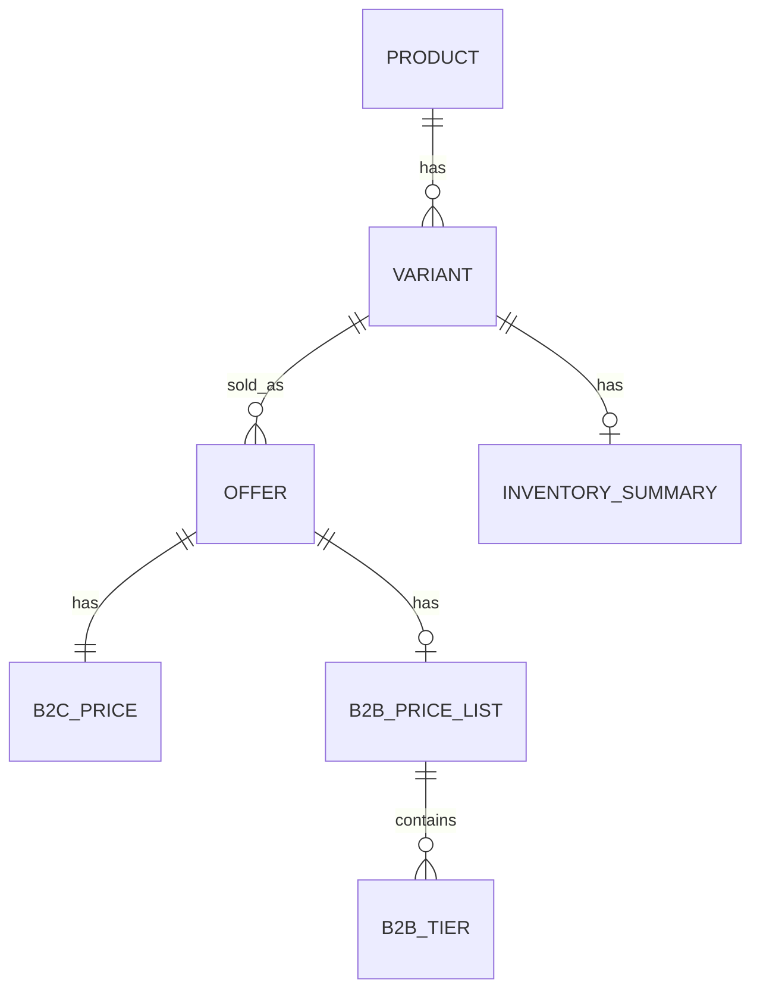
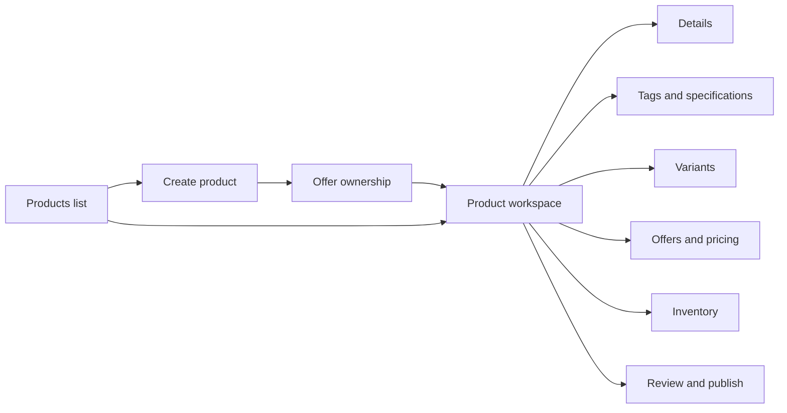
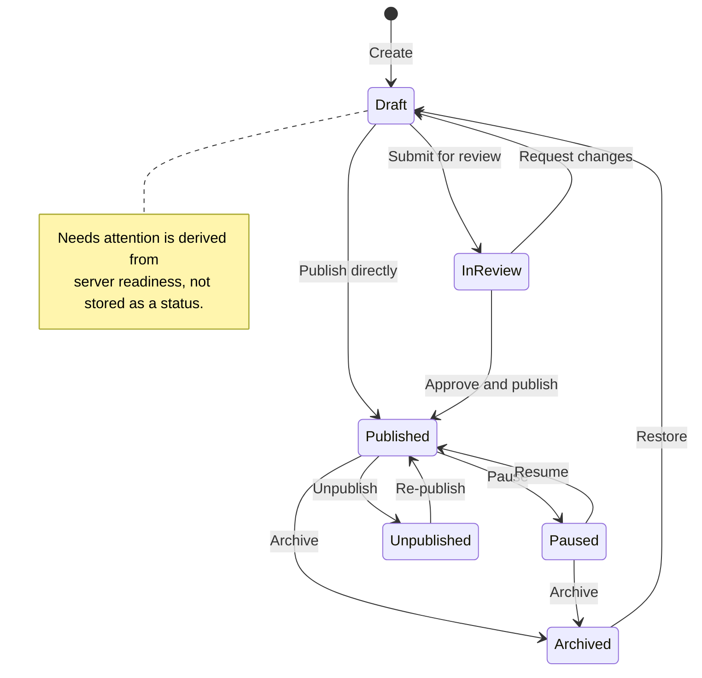

# Products workspace — revised design after GPT-5.6 Sol QC

Date: 2026-10-25
Scope: Admin and Seller product management, staging-first
QC model: `openai/gpt-5.6-sol` (high reasoning)
Status: revised design for review. The safe Admin UI slice is deployed to staging
at `f59a5f9`; the full corrected flow still waits for human decisions.
Production: not authorized

## 1. What changed after QC

The first design was rejected as **REWORK**. This revision resolves the blockers and
high findings in the screen model.

| QC finding | Design change |
|---|---|
| B1 — client/server readiness disagree | One server-owned readiness contract. The UI renders product, variant and offer checks from the server; it does not recompute publish readiness locally. |
| B2 — publish can use stale saved data | Lifecycle actions are disabled while the form is dirty. Publishing/submitting uses **Save → reload server version → action**, or an explicit **Save and publish** action that does both. |
| B3 — Admin-created products can have no offer | Creation requires an **Offer ownership** choice: BuildKart Direct, existing seller, or “no offer yet” (draft only). No-offer drafts show a pricing CTA and cannot publish. |
| B4 — structural edits can delete variants/offers | Option axes, variant deletion and SKU identity changes are locked once a product is published or an offer exists. A governed variant-change request replaces direct deletion. |
| B5 — no permission matrix | A server-enforced capability matrix controls view, create, edit, variants, pricing, review, lifecycle and inventory requests. |
| H1/H2 — renaming does not create one flow | Products owns `/products` and `/products/:id`; `/product-studio/*` redirects. Native capabilities are inventoried before the native detail is replaced. |
| H3 — published view/edit conflict | Published products open read-only. **Edit published product** unlocks a direct audited edit with **Save changes**. |
| H4 — singular price for offer-scoped data | Pricing and Review show offers, not one product price. Review shows `priced offers / total offers`. |
| H5 — “Save pricing” is not atomic | Results are shown per channel and per offer. Failed B2B or bulk items keep their inputs and can be retried. |
| H6 — inventory grain mismatch | Inventory is one row per saved variant/SKU. No seller column until a seller stock source exists. |
| H7 — unsupported fields | Collections assignment, media gallery and SEO migration are marked **Phase 2 / API required**, not implied as working. |
| H8 — weak autosave/conflict handling | Existing-product local drafts, leave protection, expected-version saves and a conflict state are specified. |
| H9 — legacy imported products | A dedicated legacy mode hides unsupported structural variant actions. |
| H10 — mixed lifecycle labels | **Publication status** and **lifecycle condition** are displayed separately. “Needs attention” is derived, not a stored status. |

## 2. Data model



```text
Product
├── Variant A (SKU-A)
│   ├── Seller 1 offer → B2C price + B2B price/MOQ/tiers/dates
│   └── Seller 2 offer → B2C price + B2B price/MOQ/tiers/dates
├── Variant B (SKU-B)
│   └── Seller 1 offer → B2C price + B2B price/MOQ/tiers/dates
└── Variant C (SKU-C)
    └── No offer yet → pricing unavailable; publish blocked
```

| Data | Level | Notes |
|---|---|---|
| Title, subtitle, descriptions, category, brand, manufacturer, model, HSN, UOM | Product | Applies to all variants |
| Thumbnail | Product | Current API supports one thumbnail URL |
| Search tags, specifications | Product | Inherited by variants |
| Variant name, SKU, details, image URL | Variant | One row per variant |
| B2C price | Offer (variant + seller) | List, selling, GST |
| B2B price, MOQ, tiers, effective dates | Offer (variant + seller) | Optional; “not configured” is valid |
| Inventory | Variant/SKU | Tryton summary; seller stock only if a source is added |
| Readiness | Product + variant + offer | Server-owned |

## 3. Navigation and routes

```text
Products  → /products
├─ Collections  → /products/collections
└─ Categories   → /products/categories
```

Product Studio is not a separate menu item.

| Route | Behaviour |
|---|---|
| `/products` | Products list; preserves search, filters and page in the URL |
| `/products/new` | Create product; offer-ownership step first |
| `/products/:id` | Product workspace. Draft opens in edit mode; published opens in view mode |
| `/products/:id/edit` | Explicit edit mode for a published product |
| `/products/:id?tab=details` | Deep link to Details |
| `/products/:id?tab=variants` | Deep link to Variants |
| `/products/:id?tab=pricing&variant=:variantId&offer=:offerId` | Deep link to a specific variant/offer |
| `/products/:id?tab=inventory` | Deep link to Inventory |
| `/products/:id?tab=review` | Deep link to Review |
| `/product-studio` | Redirect to `/products/new` |
| `/product-studio/:id` | Redirect to `/products/:id` |

List links carry a safe `returnTo` so “Back to Products” restores the previous
search, filters and page.

## 4. Screen map



## 5. Common workspace shell

```text
+------------------------------------------------------------------------------------------------------+
| ← Products    Winter Jacket    [Published] [Paused]    BuildMaster Supplies    Saved 12:42   ● Dirty |
+------------------------------------------------------------------------------------------------------+
| Details | Tags & specifications | Variants (6) | Offers & pricing (6) | Inventory (6) | Review       |
+------------------------------------------------------------------------------------------------------+
|                                                                                  | Readiness          |
|  Active section                                                                  | 1 blocker          |
|                                                                                  | 2 warnings         |
|                                                                                  | [Open Review]      |
|                                                                                  |                    |
|                                                                                  | Content preview    |
|                                                                                  | [product card]     |
+----------------------------------------------------------------------------------+--------------------+
| [Cancel]                         [Save draft] [Save changes] [Review & publish]                       |
+------------------------------------------------------------------------------------------------------+
```

Rules:

- One persistent action bar. No duplicate header and footer actions.
- Publication status and lifecycle condition are separate badges.
- `Dirty` is shown whenever local edits are not saved.
- `Review & publish` is disabled while dirty; use **Save and publish** instead.
- Right rail is a compact summary; full diagnostics live in Review.
- Preview is labelled **Content preview** unless it is a real storefront projection.
- On mobile, tabs become a dropdown, tables become cards, and the action bar has
  one primary action plus an overflow menu.

## 6. Products list

```text
+------------------------------------------------------------------------------------------------------+
| Products (289)                                              [Search] [Filters] [+ New product]       |
+------------------------------------------------------------------------------------------------------+
| Product          | Variants | Offer coverage        | Inventory     | Category    | Status     | Updated |
+------------------------------------------------------------------------------------------------------+
| Winter Jacket    | 6        | B2C 6/6 · B2B 3/6     | 5/6 checked   | Apparel     | Published  | 12:42   |
| Work Boots       | 4        | B2C 4/4 · B2B 0/4     | 4/4 checked   | Footwear    | Draft      | 11:08   |
| Safety Helmet    | 2        | B2C 1/2 · B2B 1/2     | —             | Safety      | Needs att. | 09:31   |
+------------------------------------------------------------------------------------------------------+
| Row click → Product workspace                                                                        |
+------------------------------------------------------------------------------------------------------+
```

Coverage rules:

- Offer coverage is variant-level: variants with at least one B2C offer / total variants.
- B2B coverage is variants with a configured B2B list / total variants.
- Inventory coverage is SKUs checked / total SKUs.
- `—` means unavailable, not zero.
- The list uses one aggregate endpoint; it must not issue per-row inventory calls.

Row actions:

```text
Open
Edit (permission-gated)
```

No native “Create” path.

## 7. Create product and offer ownership

The offer-ownership step prevents the zero-offer dead end.

```text
+------------------------------------------------------------------------------------------------------+
| Create product                                                                                       |
+------------------------------------------------------------------------------------------------------+
| Title                                                                                                |
| [Winter Jacket                                                                                    ]   |
|                                                                                                      |
| Offer ownership *                                                                                    |
| ( ) BuildKart Direct                                                                                 |
| (•) Existing seller    [Search seller... v]                                                          |
| ( ) No offer yet       Draft only; pricing and publish stay disabled until an offer is assigned.      |
|                                                                                                      |
| [Cancel]                                                        [Create draft]                       |
+------------------------------------------------------------------------------------------------------+
```

Behaviour:

- Seller mode: ownership is fixed to the signed-in seller; the selector is hidden.
- BuildKart Direct creates a platform-owned offer path.
- “No offer yet” saves a draft but shows a **Create seller offer** CTA in Pricing.
- Review blocks publish if a product has no sellable offer.

## 8. Details tab

```text
+------------------------------------------------------------------------------------------------------+
| Details                                                                                              |
+------------------------------------------------------------------------------------------------------+
| General                                                                                              |
| Title*                         | Subtitle (optional)                                                  |
| [Winter Jacket              ]  | [Warm and cosy jacket                                        ]      |
|                                                                                                      |
| Full description                                                                                     |
| [A warm and cosy jacket for winter use...                                                     ]      |
|                                                                                                      |
| Organisation                                                                                         |
| Category*               | Brand                 | Manufacturer             | Model / part number   |
| [Apparel             v] | [BuildKart          ] | [BuildKart Textiles    ] | [WJ-2026            ] |
|                                                                                                      |
| HSN / GST code          | Unit of measure       |                                                     |
| [6201                ]  | [piece             ]  |                                                     |
|                                                                                                      |
| Media                                                                                                |
| Thumbnail URL [https://...]  [preview]                                                               |
| Image gallery — Phase 2 / API required                                                               |
|                                                                                                      |
| SEO — Phase 1.5 / migrate from native widget                                                         |
| Meta title [____]  Meta description [____]  Handle [____]                                            |
| Until migrated: [Open native record] remains available for advanced SEO.                            |
+------------------------------------------------------------------------------------------------------+
```

Collections:

- Phase 1: display read-only collection membership and link to Collections.
- Phase 2: assign/unassign inside Details.
- This avoids inventing an unsupported save field.

Product-level only. Variant fields stay in Variants.

## 9. Tags and specifications tab

```text
+------------------------------------------------------------------------------------------------------+
| Tags & specifications                                                                                |
+------------------------------------------------------------------------------------------------------+
| Search tags                                                                                          |
| [winter] [jacket] [outerwear]  [+ Add tag]                                                           |
|                                                                                                      |
| Specifications                                                                                       |
| +----------------------+----------------------+----------------------+-----------------------------+  |
| | Name                 | Value                | Unit                 | Actions                     |  |
| | Material             | Polyester            |                      | Remove                      |  |
| | Water resistance     | 5000                 | mm                   | Remove                      |  |
| | Care                 | Machine wash         |                      | Remove                      |  |
| +----------------------+----------------------+----------------------+-----------------------------+  |
| [+ Add specification]                                                                                |
+------------------------------------------------------------------------------------------------------+
```

Tags and specifications are product-level and are warnings, not publish blockers,
unless the business later decides otherwise.

## 10. Variants tab

### 10.1 Studio-managed product, draft

```text
+------------------------------------------------------------------------------------------------------+
| Variants                                                                                             |
+------------------------------------------------------------------------------------------------------+
| Options                                                                                              |
| [Finish: Black, Silver]   [Size: S, M, L]      [Generate combinations]     2 × 3 = 6 variants        |
+------------------------------------------------------------------------------------------------------+
| Bulk SKU prefix [WJ-]  [Fill blank SKUs]                                                             |
+------------------------------------------------------------------------------------------------------+
| Variant       | SKU         | Details shown in app        | Image   | Readiness        | Actions      |
+---------------+-------------+-----------------------------+---------+------------------+--------------+
| Black / S     | WJ-BLK-S    | Water-resistant shell       | [img]   | Ready            | Edit Remove  |
| Black / M     | WJ-BLK-M    | Water-resistant shell       | [img]   | Needs details    | Edit Remove  |
| Black / L     | WJ-BLK-L    | Water-resistant shell       | [img]   | Ready            | Edit Remove  |
| Silver / S    | WJ-SLV-S    | Water-resistant shell       | [img]   | Ready            | Edit Remove  |
| Silver / M    | WJ-SLV-M    | Water-resistant shell       | [img]   | Ready            | Edit Remove  |
| Silver / L    | WJ-SLV-L    | Water-resistant shell       | [img]   | Needs SKU        | Edit Remove  |
+---------------+-------------+-----------------------------+---------+------------------+--------------+
| 6 variants · 6 SKUs · 0 duplicate SKUs                                                               |
+------------------------------------------------------------------------------------------------------+
```

Readiness labels are derived in the UI: `Ready`, `Needs details`, `Needs SKU`.
There is no separate stored variant status.

### 10.2 Published or offered product — structural lock

```text
+------------------------------------------------------------------------------------------------------+
| This product is published / has offers.                                                              |
| Option axes, variant deletion and SKU identity changes are locked.                                   |
| To change the sellable structure, submit a variant change request.                                   |
| [Request variant change]                                                                             |
+------------------------------------------------------------------------------------------------------+
```

- “Add option”, “Generate combinations” and “Remove” are disabled.
- Variant name, details and image remain editable where permitted.
- SKU changes are blocked if the SKU is referenced by an offer or order.
- A variant change request must show affected offers, prices and inventory before
  approval.

### 10.3 Legacy / imported product

```text
+------------------------------------------------------------------------------------------------------+
| Imported catalogue product                                                                           |
| Option axes are read-only in this slice.                                                             |
| Variant names, details, images and SKUs remain editable.                                             |
+------------------------------------------------------------------------------------------------------+
```

Hide Generate/Remove/Add-axis controls. Allow only supported remediation needed
for republishing.

Adding a variant creates new rows in Offers & pricing and Inventory. Removing a
draft variant removes those unsaved rows; removing an offered variant is blocked.

## 11. Offers and pricing tab

```text
+------------------------------------------------------------------------------------------------------+
| Offers & pricing                                                                                     |
| Bulk reference pricing: List price [_____] GST [x] [Preview scope] [Apply to all offers]             |
+----------------------+-------------------------------------------------------------------------------+
| Variants             | Black / S · WJ-BLK-S                                                          |
|                      |                                                                               |
| > Black / S   2 offers| +---------------------------------------------------------------------------+ |
|   Black / M   1 offer | | BuildMaster Supplies        B2C configured    B2B configured               | |
|   Black / L   1 offer | | B2C: list ₹4,999  selling ₹4,499  GST 18%                                | |
|   Silver / S  1 offer | | B2B: list ₹4,799  selling ₹4,299  MOQ 6  dates 01-Oct → 31-Dec          | |
|   Silver / M  0 offers| | Tiers: 6–11 @ ₹4,199 · 12+ @ ₹4,099                                     | |
|   Silver / L  1 offer | | [Save pricing]                                                           | |
|                      | +---------------------------------------------------------------------------+ |
|                      | | PowerMax Depot              B2C configured    B2B not configured            | |
|                      | | B2C: list ₹5,099  selling ₹4,599  GST 18%                                | |
|                      | | B2B: not configured  [Configure B2B]                                     | |
|                      | | [Save pricing]                                                           | |
|                      | +---------------------------------------------------------------------------+ |
+----------------------+-------------------------------------------------------------------------------+
| Coverage: B2C 5/6 variants · B2B 3/6 variants                                                       |
+------------------------------------------------------------------------------------------------------+
```

Rules:

- Each variant can have zero, one or many seller offers.
- Each offer has its own B2C and B2B pricing.
- B2B includes MOQ, tiers, GST and effective dates.
- A configured B2B block has a **Clear B2B** action.
- Zero offers shows an authorized CTA, not only text:

```text
Silver / M · No seller offer yet
Pricing is disabled until an offer exists.
[Assign seller / Create offer]
```

- Bulk reference pricing shows a scope preview before applying. Results are
  per offer:

```text
Bulk result: 18 updated · 2 skipped · 1 failed
[Retry failed]
```

- Save pricing reports channel-specific outcomes:

```text
B2C saved. B2B failed: MOQ must be at least 1.
[Retry B2B]
```

- Review uses offer counts, not one product price:

```text
Priced offers: 8/11 · Variants with B2C: 5/6 · Variants with B2B: 3/6
```

Optional comparison view:

```text
+-------------+------------------+------------+------------+------+-------------+
| Variant/SKU | Seller           | B2C selling| B2B selling| MOQ  | B2B status  |
+-------------+------------------+------------+------------+------+-------------+
| WJ-BLK-S    | BuildMaster      | ₹4,499     | ₹4,299     | 6    | Configured  |
| WJ-BLK-S    | PowerMax         | ₹4,599     | —          | —    | Not set     |
| WJ-BLK-M    | BuildMaster      | ₹4,499     | ₹4,299     | 6    | Configured  |
| WJ-SLV-M    | —                | —          | —          | —    | No offer    |
+-------------+------------------+------------+------------+------+-------------+
```

## 12. Inventory tab

```text
+------------------------------------------------------------------------------------------------------+
| Inventory                                                                                            |
| Tryton is the inventory authority. Adjustment requests never write stock directly.                  |
+------------------------------------------------------------------------------------------------------+
| Variant / SKU        | On hand | Reserved | ATP | Tryton status   | Checked at | Action              |
+----------------------+---------+----------+-----+-----------------+------------+---------------------+
| Black / S · WJ-BLK-S | 42      | 6        | 36  | Synced          | 12:40      | Request adjustment  |
| Black / M · WJ-BLK-M | 18      | 2        | 16  | Synced          | 12:40      | Request adjustment  |
| Black / L · WJ-BLK-L | 0       | 0        | 0   | Zero            | 12:40      | Request adjustment  |
| Silver / S · WJ-SLV-S| —       | —        | —   | Not in Tryton   | —          | Request adjustment  |
| Silver / M · WJ-SLV-M| —       | —        | —   | Unavailable     | —          | Request adjustment  |
+----------------------+---------+----------+-----+-----------------+------------+---------------------+
| Coverage: 3/5 checked · 1 zero · 1 not found · 1 unavailable                                       |
+------------------------------------------------------------------------------------------------------+
```

Rules:

- One row per saved variant/SKU.
- No seller column until a seller stock source exists.
- `Checked at` is the time the check ran, not a supplier sync timestamp.
- `Not in Tryton`, `Unavailable` and `Unsaved SKU` are distinct states.
- If an adjustment request requires an offer and several offers share the SKU,
  open a modal to choose the audited offer/seller.
- Unsaved SKUs show `Unsaved SKU` and cannot be adjusted until saved.

## 13. Review and publish tab

```text
+------------------------------------------------------------------------------------------------------+
| Review                                                                                               |
| Publication status: Draft        Lifecycle condition: —        Server checked: 12:44                 |
| Blockers: 1       Warnings: 2                                                                        |
+------------------------------------------------------------------------------------------------------+
| Product checks                                                                                       |
| ✓ Title   ✓ Category   ✓ At least one variant   ! Search tags   ! Specifications                     |
+------------------------------------------------------------------------------------------------------+
| Variant checks                                                                                       |
| Variant       | Name | Details | SKU | B2C offer | B2B offer | Inventory | Result                   |
+---------------+------+---------+-----+-----------+-----------+-----------+--------------------------+
| Black / S     | ✓    | ✓       | ✓   | ✓         | ✓         | ✓         | Ready                    |
| Black / M     | ✓    | ✓       | ✓   | ✓         | ✓         | ✓         | Ready                    |
| Black / L     | ✓    | ✓       | ✓   | ✓         | ✓         | ✓         | Ready                    |
| Silver / S    | ✓    | ✓       | ✓   | ✓         | —         | ✓         | Warning: no B2B          |
| Silver / M    | ✓    | ✗       | ✓   | ✓         | —         | !         | Blocker: details missing |
| Silver / L    | ✓    | ✓       | ✓   | ✓         | —         | ✓         | Warning: no B2B          |
+---------------+------+---------+-----+-----------+-----------+-----------+--------------------------+
| Blockers prevent publish. Warnings do not.                                                           |
+------------------------------------------------------------------------------------------------------+
| Offer readiness (expand a variant)                                                                   |
| Black / S → BuildMaster B2C ✓ B2B ✓   PowerMax B2C ✓ B2B —                                          |
+------------------------------------------------------------------------------------------------------+
| Content preview                                                                                      |
| [product card]  Winter Jacket · 6 variants · from ₹4,499                                              |
+------------------------------------------------------------------------------------------------------+
| [Save draft] [Submit for review] [Publish] [Unpublish] [Pause] [Archive]                             |
+------------------------------------------------------------------------------------------------------+
```

Rules:

- Readiness is **server-owned**. The UI displays it; it does not recalculate it.
- Product, variant and offer checks are all returned by the same readiness call.
- A blocker links to the failing tab/variant/offer.
- Lifecycle actions are disabled while dirty.
- `Publish` on a dirty draft becomes **Save and publish**; on a dirty published
  product it becomes **Save changes** and the lifecycle action remains separate.
- The server returns a version; the action uses that version and fails on conflict.
- “Needs attention” is derived from blockers/warnings; it is not a stored status.
- Preview is labelled **Content preview** unless it is a real B2C/B2B projection.

## 14. Lifecycle and modes

### Publication status vs lifecycle condition



- **Publication status**: Draft, In review, Published.
- **Lifecycle condition**: Paused, Unpublished, Archived.
- **Needs attention**: derived from readiness; not stored.
- **Restore**: an action, not a status.

### Mode matrix

| State | Seller | Admin |
|---|---|---|
| New | Create draft; offer ownership fixed to seller | Choose offer ownership; create draft |
| Draft / Needs attention | Edit, Save draft, Submit | Edit, Save draft, Submit |
| In review | View, Withdraw | Approve & publish, Request changes, Reject |
| Published | View by default; Edit → Save changes (audited) | View by default; corrective Edit → Save changes |
| Paused / Unpublished | Permission-dependent view/actions | Resume / re-publish / archive |
| Archived | View only | Restore |

## 15. Permission matrix

| Capability | Super Admin | Marketplace Operator | Seller Admin | Seller Catalogue | Seller Orders | Support |
|---|---|---|---|---|---|---|
| View products | ✓ | ✓ | own | own | own | ✓ |
| Create product | ✓ | ✓ | ✓ | ✓ | — | — |
| Edit content | ✓ | ✓ | own | own | — | — |
| Edit variants | ✓ | ✓ | own | own | — | — |
| Change structure (options/delete/SKU) | ✓ | ✓ | own, if unpublished | own, if unpublished | — | — |
| Price B2C | ✓ | ✓ | own | own | — | — |
| Price B2B | ✓ | ✓ | own | own | — | — |
| Submit / withdraw | ✓ | ✓ | own | own | — | — |
| Approve / publish | ✓ | ✓ | — | — | — | — |
| Pause / unpublish | ✓ | ✓ | own, if allowed | — | — | — |
| Archive / restore | ✓ | ✓ | — | — | — | — |
| Inventory adjustment request | ✓ | ✓ | own | own | — | — |

Server enforcement is mandatory. The UI uses the same capability response to hide
or disable controls.

## 16. Save, autosave and conflicts

- Local recovery works for **new and existing** products.
- The UI labels what is locally saved and what is saved to the server.
- Leaving a dirty workspace prompts: Stay / Discard / Save.
- Product save sends an expected version.
- A conflict shows: Reload server version / Compare / Overwrite (permission-gated).
- Pricing has its own dirty state and save result.
- Lifecycle actions never run on unsaved changes.
- “Save draft” is used for drafts; “Save changes” is used for published edits.
- Published edits show a clear warning: changes go live immediately and are audited.

## 17. Accessibility and responsive rules

- Semantic tabs with arrow-key navigation and correct `aria-selected`.
- 44px minimum targets.
- Status uses text plus icon, never colour alone.
- Save/error notices use `aria-live`.
- Field errors use `aria-invalid` and are linked to the input.
- On focus, move to the first blocker in Review.
- Mobile:
  - tabs become a dropdown;
  - tables become cards;
  - variant selector becomes a searchable dropdown;
  - one sticky action bar, no overlapping fixed regions.
- Wide pricing tables get horizontal scroll or a card layout, never clipped text.

## 18. Phase 1 / Phase 2 scope

### Phase 1

- Products menu, list, create with offer ownership.
- Details with supported fields.
- Tags and specifications.
- Variants with studio-managed and legacy modes.
- Structural lock for published/offered products.
- Offers and pricing with variant/offer layout, channel-specific results and retry.
- Inventory by SKU with adjustment requests.
- Server-owned readiness, save-before-action, permissions, versioning.
- Lifecycle actions and audit.

### Phase 2 / API required

- Collections assignment from Details.
- Product media gallery.
- SEO migration from the native widget.
- Real B2C/B2B storefront preview.
- Seller-wise inventory.
- Variant change request migration workflow.
- Aggregate list coverage endpoint if not delivered in Phase 1.

## 19. QC acceptance checklist

| QC ID | Acceptance criterion |
|---|---|
| B1 | One server readiness response covers product, variant and offer checks; Admin and Seller render it unchanged. |
| B2 | Lifecycle actions are disabled while dirty; publish/submit uses a saved server version. |
| B3 | Creating a product requires offer ownership, or explicitly creates a no-offer draft with pricing disabled and publish blocked. |
| B4 | Option axes, variant deletion and SKU identity changes are locked on published/offered products. |
| B5 | Every capability in the permission matrix is enforced server-side and reflected in the UI. |
| H1 | `/product-studio/*` redirects; all internal links point to `/products/*`. |
| H2 | Native product capabilities, including SEO, are inventoried before the native detail is replaced. |
| H3 | Published products open read-only with an explicit, permission-gated Edit action. |
| H4 | Pricing and Review show offer-level rows/counts, not one product price. |
| H5 | B2C/B2B and bulk saves show per-channel/per-offer results and support retry. |
| H6 | Inventory is one row per variant/SKU; no seller column without a seller stock source. |
| H7 | Collections, media gallery and SEO are labelled Phase 2/API required, not implied as working. |
| H8 | Existing-product drafts, leave protection, expected-version saves and conflict handling are implemented. |
| H9 | Legacy/imported products hide unsupported structural variant actions. |
| H10 | Publication status and lifecycle condition are separate; “Restore” is an action. |
| M1 | Products list uses an aggregate coverage endpoint and distinguishes unavailable from zero. |
| M2 | One persistent action bar; no duplicated header/footer actions. |
| M3 | Tabs, variants, offers and list return context are deep-linkable and refresh-safe. |
| M4 | Tabs, tables and action bars meet the accessibility/responsive rules. |
| M5 | Preview is labelled Content preview unless it uses the real storefront projection. |

## 20. Human decisions required

1. **Admin offer ownership:** BuildKart Direct by default, required seller selection,
   or both?
2. **Publish rule:** At least one priced B2C offer per variant, or every active offer
   fully priced?
3. **Published structural edits:** Lock permanently, or build a variant-change
   migration flow in Phase 1?
4. **Seller lifecycle rights:** Can sellers pause, unpublish, archive and restore?
5. **Collections/media/SEO:** Confirm Phase 2, or bring any into Phase 1.
6. **Coverage metrics:** Variant coverage, offer coverage, or both on the list?
7. **B2B removal:** Confirm the Clear B2B action and audit behaviour.
8. **Inventory adjustment ownership:** When several offers share one SKU, who owns
   the request?
9. **Preview fidelity:** Content preview acceptable for Phase 1, or is a real
   B2C/B2B projection required?

No implementation was performed. Production remains unauthorized.
